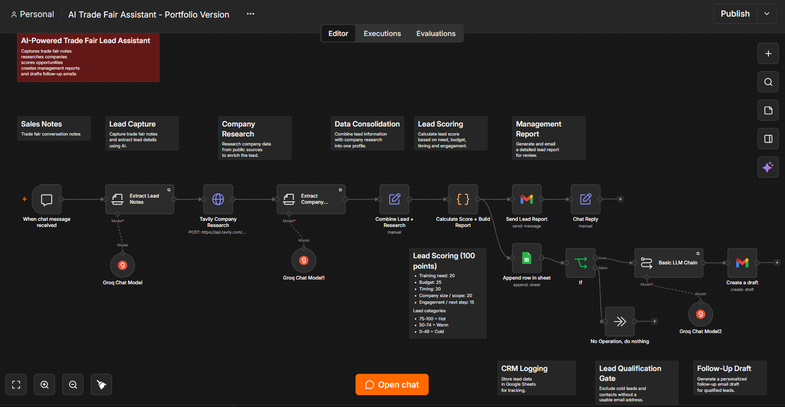
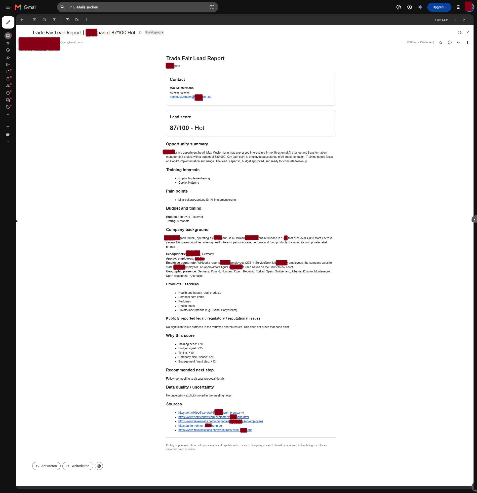
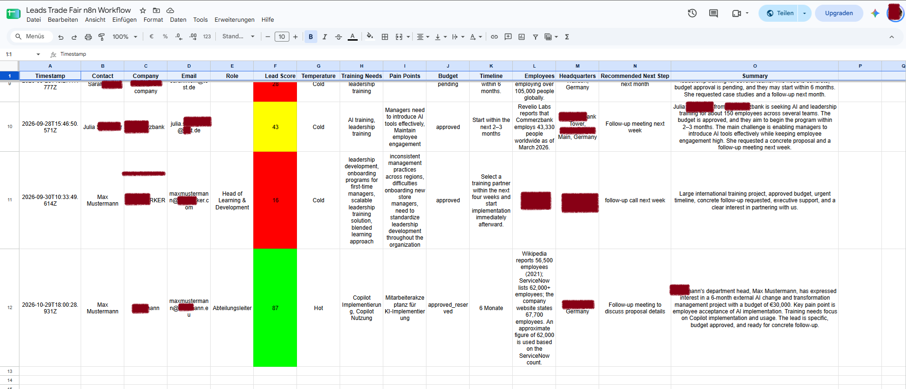
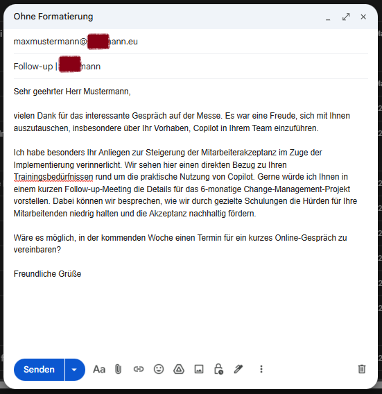

# n8n Trade Fair Assistant Prototype

An AI-powered lead qualification and follow-up workflow built with n8n.

This workflow transforms unstructured trade fair conversation notes into enriched sales opportunities by combining AI-powered lead extraction, company research, lead scoring, CRM logging, automated reporting, and follow-up email drafting.

---

## Overview

Many trade fair leads are documented inconsistently, making qualification and follow-up activities difficult and time-consuming.

This prototype automates the process by:

- Extracting lead information from conversation notes
- Enriching leads with public company research
- Calculating an opportunity score
- Generating management-ready reports
- Logging lead data into Google Sheets
- Creating personalized follow-up email drafts

---

## Workflow Overview

### Process Flow

1. Capture trade fair conversation notes
2. Extract lead details using AI
3. Research company information using public sources
4. Consolidate lead and company data
5. Calculate lead score and qualification
6. Generate a management report
7. Store lead information in Google Sheets
8. Create a personalized follow-up email draft

---

## Key Features

### AI Lead Extraction

Automatically identifies:

- Contact information
- Company details
- Training needs
- Pain points
- Budget indicators
- Timeline indicators
- Follow-up requests

### Company Research

Retrieves publicly available information such as:

- Company description
- Headquarters
- Employee count
- Products and services
- Geographic presence
- Relevant public information

### Lead Scoring

Lead qualification based on the following model:

| Factor | Weight |
|----------|----------:|
| Training Need | 20 |
| Budget | 25 |
| Timeline | 20 |
| Company Size / Scope | 20 |
| Engagement / Next Step | 15 |

#### Lead Categories

- Hot: 75-100
- Warm: 50-74
- Cold: 0-49

### Automated Reporting

Generates structured management reports including:

- Opportunity summary
- Lead score
- Company background
- Recommended next actions
- Supporting research sources

### CRM Logging

Stores qualified lead information in Google Sheets for tracking and follow-up management.

### Follow-Up Drafting

Creates personalized outreach drafts based on:

- Conversation content
- Identified needs
- Pain points
- Recommended next steps

---

## Example Outputs

### Lead Report

### CRM Lead Sheet

### Follow-Up Email Draft

---

## Technology Stack

- n8n
- Groq
- Tavily Search API
- Gmail
- Google Sheets
- Python Code Node

---

## Use Case

This workflow was created as a prototype for automating trade fair lead qualification and follow-up activities.

The objective is to reduce manual effort, improve lead consistency, enrich sales conversations with external research, and accelerate post-event business development.

---

## Repository Contents

| File | Description |
|--------|--------|
| workflow.json | Complete n8n workflow export |
| workflow.png | Workflow overview |
rt |
| follow_up_draft.png | Example follow-up email draft |

---

## License

MIT License
